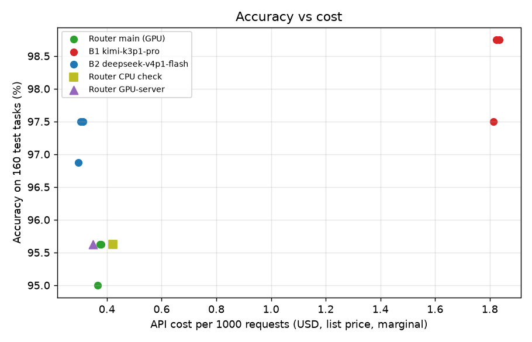
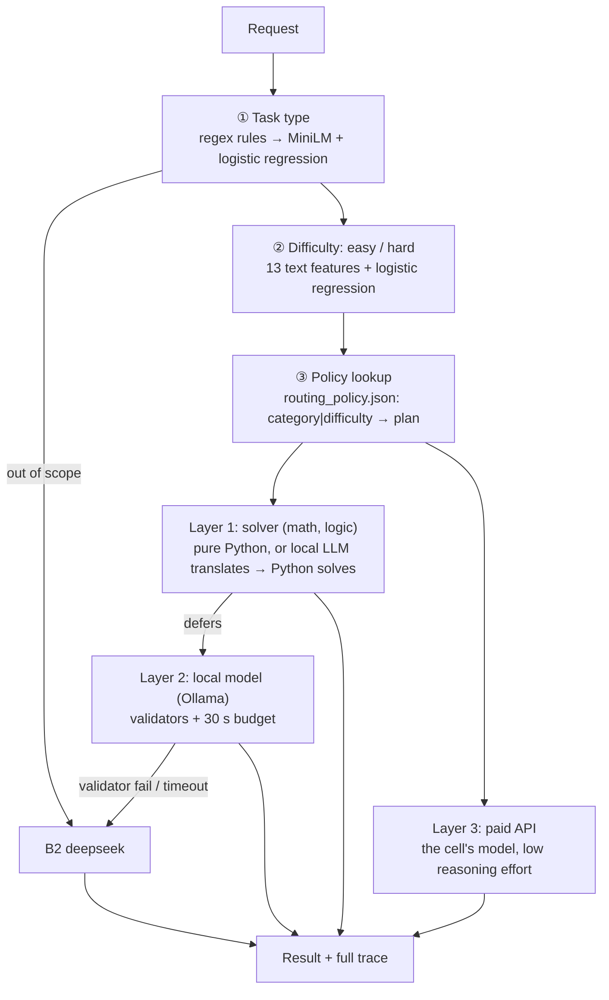

# Hybrid LLM Router

**Send each request to the cheapest path that is still good enough: a Python solver, a small local model, or a paid API. The routing table is built from a 16-model benchmark and checked on held-out data.**

[](https://www.python.org/downloads/)
[](https://fastapi.tiangolo.com/)
[](https://ollama.com/)
[](https://opensource.org/licenses/MIT)

## Results on 160 held-out test tasks

Everything was frozen before the test split was opened (git tag `phase6-frozen` plus SHA-256 hashes in
[`eval/results/phase6/FREEZE.md`](eval/results/phase6/FREEZE.md)). Each system ran 3 times and the mean ± spread is shown.
The full report is [`eval/results/phase6/final_report.md`](eval/results/phase6/final_report.md).

| System | Accuracy | Wilson 95% CI | Cost for 160 tasks (list price) |
|---|---|---|---|
| **Router** (main policy) | **95.4% ± 0.3** | 91.2–97.9% | **$0.0596** |
| B1: always `kimi-k3p1-pro` (most accurate model) | 98.3% ± 0.6 | 94.6–99.4% | $0.2920 |
| B2: always `deepseek-v4p1-flash` (cheapest model that passed the quality check) | 97.3% ± 0.3 | 93.7–99.0% | $0.0487 |

- **Cost vs B1:** 79.6% cheaper (local inference counted as $0), or 71.0% after pricing the hardware. Across the four traffic mixes the saving is 66.9–96.1%.
- **Answered without a paid call:** about 42% of requests (solver or local model). On a CPU-only box this falls to 34%.
- **Solver precision:** 100%. Every answer the Python solver gave was correct.
- **Quality guardrail on test: failed.** The router has to be at most 3 points worse than B1 at 95% confidence. On test the gap was −2.9 points, with a lower bound of −5.4. Most of the loss is four `code_debug` tasks that a 1.5B local coder model gets wrong in every run.
- **Against B2, the router is not cheaper** (−22.6%). Most of the saving against B1 comes from *model selection*: the benchmark found that a cheap API model is nearly as accurate as the premium one.



## How it works



| Cell | Easy | Hard |
|---|---|---|
| factual | phi3.5:3.8b (local) | phi3.5:3.8b (local) |
| math | solver → qwen3:1.7b (local) | solver → gemma3:4b (local) |
| logic | solver → glm-5.3-flash | solver → gpt-oss-120b |
| sentiment | llama3.2:3b (local) | gemma3:4b (local) |
| code_debug | qwen2.5-coder:1.5b (local) | glm-5.3-flash |
| code_gen | llama3.2:3b (local) | gpt-oss-120b |
| ner | glm-5.3-flash | glm-5.3-flash |
| summarisation | deepseek-v4p1-flash (B2) | kimi-k3p1-pro (B1) |

Out-of-scope prompts and any local answer that fails a validator or times out go to B2.

## How the policy was built

The work ran in phases, and only the 240 **dev** tasks were used to build anything.

| Phase | What | Report |
|---|---|---|
| 0 | Checked which providers and models work and recorded their list prices | [`phase0_report.md`](eval/results/phase0_report.md) |
| 1 | **Dataset:** 8 task types × 50 tasks (25 easy, 25 hard) with automatic graders, split 240 dev / 160 test. Test math and logic items use templates that were never used to build the solvers. | [`phase1_report.md`](eval/results/phase1_report.md) |
| 2 | **Grading:** unit tests in a sandbox for code, exact match, NER entity match, and an LLM judge for factual answers and summaries. The judge was calibrated against 40 hand labels (GLM-5.3-flash agreed on 92.5%). | [`judge_decision.md`](eval/results/judge_decision.md) |
| 3 | **Benchmark:** 16 models (8 local at ≤4 GB VRAM, 8 API from 7 makers) plus 3 GPU-server models, all on the dev split | [`benchmark_report.md`](eval/results/phase3/benchmark_report.md) |
| 4 | **Policy:** classifiers, solvers and the D13 translator, validators, a power analysis, the cell rule, the whole-router guardrail and the baselines | [`policy_report.md`](eval/results/phase4/policy_report.md) |
| 5 | **Router:** production package, batch CLI, `POST /v1/route`; a replay check confirms the code matches the Phase 4 simulation | [`phase5_report.md`](eval/results/phase5_report.md) |
| 6 | **Final test:** freeze, then the router ×3 on GPU, 1 CPU-only run, 1 GPU-server run, and B1 and B2 ×3 each | [`final_report.md`](eval/results/phase6/final_report.md) |

**The routing rule (D12).**
- **Per cell** (category × difficulty, 15 dev tasks each): use the cheapest option that has at most one more miss than B1 and at least 80% accuracy.
- **Whole router** (240 dev tasks): replay the full cascade with out-of-fold *predicted* labels. The router must be at most 3 points worse than B1 at 95% confidence (one-sided paired bootstrap). While it fails, the worst cell is handed back to its next option up.
- **Why the per-cell test is a plain count:** a power analysis showed a significance test on 15 tasks would reject an equally good model 25–70% of the time.

Every choice and the reason behind it is in [`docs/DESIGN_DECISIONS.md`](docs/DESIGN_DECISIONS.md) (D1–D13).

### Dev vs test

| | Dev (240) | Test (160) |
|---|---|---|
| Router | 97.9% · 81.7% cheaper than B1 · guardrail **passed** | 95.4% · 79.6% cheaper · guardrail **failed** |
| B1 / B2 | 99.2% / 98.8% | 98.3% / 97.3% |

The router lost more accuracy from dev to test than either baseline. That is expected when each cell picks the option that looked best on only 15 tasks (the winner's curse), and it is why the test split existed.

## Quickstart

```bash
python -m venv .venv && .venv/Scripts/activate      # Linux/macOS: source .venv/bin/activate
pip install -e .
cp .env.example .env                                  # then fill in the keys you have
ollama pull gemma3:4b phi3.5:3.8b qwen3:1.7b llama3.2:3b qwen2.5-coder:1.5b
```

`.env` holds the keys and is never committed. The variable names are `FIREWORKS_API_KEY`, `HYDE_API_KEY`, `HYDE_BASE_URL` and (optionally) `GOOGLE_API_KEY`. Router settings come from environment variables:

| Variable | Default | Meaning |
|---|---|---|
| `ROUTER_POLICY_PATH` | `eval/results/phase4/routing_policy.json` | Policy file. Use `routing_policy_gpu_server.json` for the GPU-box scenario. |
| `ROUTER_LOCAL_CPU_ONLY` | `1` | Run Ollama models on CPU |
| `ROUTER_LOCAL_BUDGET_S` | `30` | Time budget for the whole local layer per request |
| `ROUTER_REASONING_EFFORT` | `low` | Reasoning effort for API models |
| `OLLAMA_HOST` | `http://localhost:11434` | Ollama server |

**Batch run:**

```bash
python -m router.run tasks.json results.json --log run.jsonl --embed inprocess --api-workers 8 --resume
```

**HTTP API:**

```bash
uvicorn src.main:app --reload
curl -X POST localhost:8000/v1/keys -H "Content-Type: application/json" -d '{"name": "dev"}'   # returns a key once
curl -X POST localhost:8000/v1/route -H "Content-Type: application/json" -H "X-API-Key: <key>" \
     -d '{"prompt": "What is 17 * 23?"}'
```

The response includes the answer, category, difficulty, layer (solver / local / API), model, cost, saving vs B1, latency, whether it escalated, and a step-by-step trace.

**Tests:**

```bash
python -m pytest tests router eval -q     # no network calls
```

## Repository layout

```
router/                 the hybrid router (Phases 4-5)
  labeler.py            task-type + difficulty classification
  classify.py, difficulty.py, embeddings.py, embed_fast.py
  policy.py             loads and validates routing_policy.json
  pipeline.py           solver → local → API cascade, escalation, time budget
  solvers/              pure-Python math/logic solvers + D13 translator
  validators.py         per-category output checks for local answers
  models.py             Ollama / Fireworks / Hyde / Gemini clients, cost accounting
  run.py                batch CLI       logging.py  JSONL request log
  recorded.py, replay_check.py   replay consistency check against Phase 4
  tests/
src/                    FastAPI service (POST /v1/route; legacy v1 endpoints kept)
eval/
  tasks_8cat.json       the 400-task dataset (frozen)
  gen/                  dataset generators and item files
  graders/              exact, numeric, NER, code sandbox, constraints, LLM judge
  run_api.py, grade.py  benchmark runner and grader
  phase4/               classifiers, solvers, translators, power analysis, policy builder
  phase6_*.py           final test runner, grading and report
  results/              every report, raw answers, graded scores and plots (phase0 … phase6)
notebooks/              Kaggle notebooks for local-model benchmarks and the final runs
docs/
  DESIGN_DECISIONS.md   D1–D13, the reasons behind every choice
  PHASE1/5/6_PLAN.md    phase plans
  legacy/               notes from the first version
scripts/                provider checks and setup helpers
```

## Limitations

- **Small dataset.** There are 15 dev tasks per cell, so per-cell numbers are point estimates.
- **Synthetic, English-only tasks.** Real traffic is messier.
- **Validators check format, not correctness.** A well-formed but wrong answer, such as code that compiles but fails tests, is accepted.
- **Difficulty classifier is weak.** It scored 75% on dev but only 65% on test.
- **API models were benchmarked at low reasoning effort.** This is how they would be deployed cheaply, not their best accuracy.
- **Costs use list prices.** The hardware cost assumes $0.05/h for CPU and $0.35/h for a T4 and leaves out idle time.

## Next steps

- An execution-based validator for code (run the example in the prompt before accepting an answer)
- Warm local models, to avoid the cold-start timeouts seen in the first run
- A larger dataset and a real-traffic sample to estimate the actual task mix
- A learned router that predicts each model's chance of success, instead of a lookup table
- Confidence-based escalation (log-probs, self-consistency)

## Version 1 and credit

This repository started as a fork of [`Asirwad/smart-llm-router`](https://github.com/Asirwad/smart-llm-router). That project provided the FastAPI service, three Gemini tiers, a semantic cache and cost accounting, and the `src/` service still builds on it.

The first version of this fork measured the original router on 108 prompts:
- **Cost:** 48.1% cheaper than always using `gemini-2.5-pro`. This was a cost-only comparison; answers were not graded.
- **Classifier:** an LLM-based classifier was compared with a rule-based one.
- **Semantic cache:** the threshold was validated, and its 0.92 cut-off produced 3 false positives.

Those reports remain in `eval/results/` (`classification_report.md`, `cost_tradeoff_report.md`, `threshold_sweep_report.md`), and the v1 notes are in [`docs/legacy/`](docs/legacy/). The hybrid router above replaced the v1 routing and evaluation.

## License

MIT
