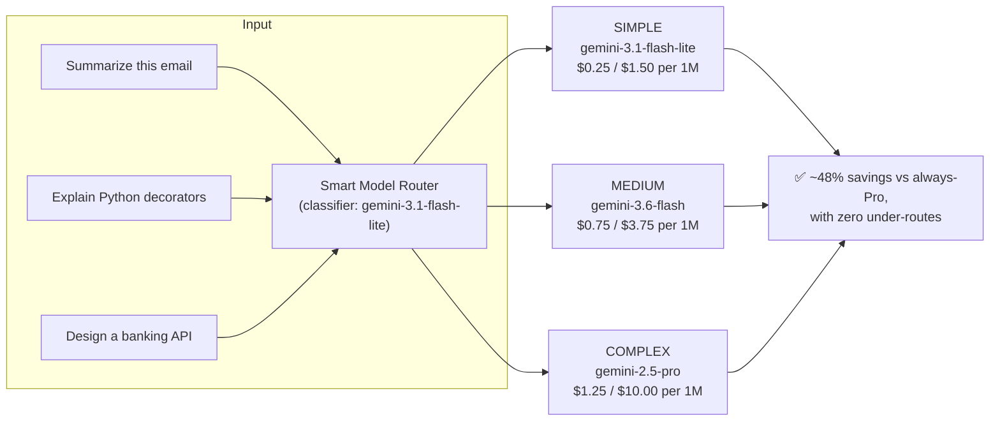
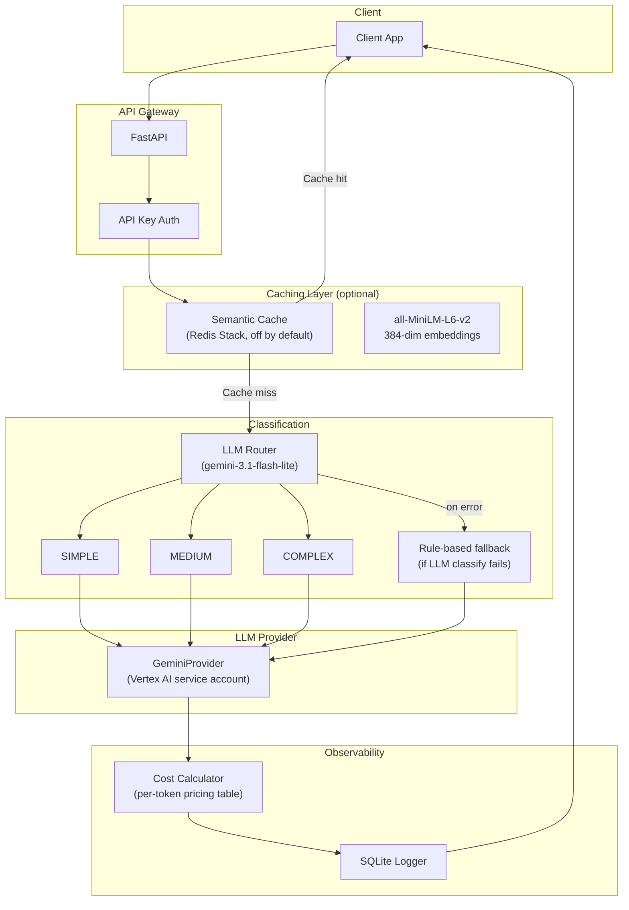

# Smart Model Router

**An LLM routing system that cuts inference cost by sending each prompt to the cheapest model that can still answer it well — with an evaluation harness that proves the routing decisions are sound.**

[](https://www.python.org/downloads/)
[](https://fastapi.tiangolo.com/)
[](https://opensource.org/licenses/MIT)

> ## Where this comes from
>
> This project extends **[`Asirwad/smart-llm-router`](https://github.com/Asirwad/smart-llm-router)**. Credit for the
> core architecture — FastAPI gateway, difficulty-tiered routing, semantic cache, per-request cost accounting —
> belongs to that repo. This fork keeps the architecture and rebuilds the **evaluation** story on top of it, because
> a router that picks the wrong tier silently is worse than no router at all.
>
> ### The four extensions, and what each one found
>
> | Extension | What it adds | Headline result |
> |---|---|---|
> | **Labeled eval harness** | 108 prompts + a written rubric (SIMPLE/MEDIUM/COMPLEX = *cheapest tier that still gives an acceptable answer*, not length or vibe) | `eval/labeled_prompts.json`, `eval/LABELING_RUBRIC.md` |
> | **Classifier accuracy** | Rule-based vs LLM-based classifier, measured on the same 108 prompts, confusion matrices for both | LLM **79.6%** vs rule-based **50.9%**; the rule-based classifier **never predicted COMPLEX once** (0.00 recall on that class across all 108 prompts) |
> | **Cost/accuracy tradeoff** | All 108 prompts through the real pipeline, **plus a real separate baseline generation on the Pro model for every prompt** (audited, not estimated) | **48.1% savings ($0.149)**; **zero under-routes** — not one hard prompt ever got a cheap answer. 19% over-routed, all one fixable pattern |
> | **Cache threshold validation** | 54 hand-labeled prompt pairs embedded with the production model, swept across similarity thresholds | The hardcoded **0.92 has 3 false positives** (trap pairs at sim 0.96–0.99 — e.g. "direct listing over an IPO" vs "an IPO over a direct listing" at 0.9936). Not defensible as-is; no clean better number for this embedding model |
>
> Full history, rationale, and the bugs found and fixed along the way: [`PROJECT_LOG.md`](PROJECT_LOG.md).
> Eval harness, data, and result reports: [`eval/`](eval/) — start at `eval/README.md`.
>
> **Stack changes from the base repo** (documented in `PROJECT_LOG.md` Phase 1): Gemini-only via Vertex AI service-account auth · SQLite instead of Postgres · local `sentence-transformers/all-MiniLM-L6-v2` embeddings instead of Ollama · semantic cache off by default (degrades to a no-op).

---

## 🎯 The Problem

**LLM API costs scale with the model you pick, not the difficulty of the task.** Sending every request to a Pro-tier model means paying Pro prices for the large fraction of prompts that a cheap model answers just as well. Picking the model by hand per prompt doesn't scale.

A router fixes this *if* its routing decisions are trustworthy. A router that silently sends a hard prompt to a cheap model produces confidently-wrong answers the user can't detect — strictly worse than no router. So this project treats the evaluation of the router as the actual deliverable, not an afterthought.

---

## 💡 The Solution

Smart Model Router is a **drop-in proxy** between your application and Gemini. A cheap classifier grades each prompt's difficulty and routes it to the lowest tier that can answer it:



All three tiers are Gemini, reached through a single auth path (Vertex AI). The price spread between the cheapest and most expensive tier is what makes routing worth doing — and the eval harness measures whether the router actually exploits it safely.

---

## 🏗️ Architecture



---

## ✨ Key Features

### 🧠 Intelligent Routing
- **LLM-Based Classification**: a cheap model (`gemini-3.1-flash-lite`) grades each prompt's complexity. Measured at **79.6% accuracy** vs **50.9%** for the rule-based fallback (Phase 3).
- **Rule-Based Fallback**: heuristic scoring (token count, keyword/code detection) used only if the LLM classifier errors — and the response is flagged so an eval run can't mistake fallback output for the LLM's.
- **Force Override**: API parameter (`force_tier`) to bypass routing for testing or specific use cases; a "give me the best model" keyword override is honored by both routers.

### 🚀 Semantic Caching (optional, off by default)
- **Embedding-Based Similarity**: local `sentence-transformers/all-MiniLM-L6-v2` (384-dim) prompt embeddings — no network round-trip on the cache hot path.
- **Redis Vector Search**: `FT.SEARCH` with KNN finds similar prompts, not just exact matches. Needs Redis Stack (RediSearch module).
- **Degrades Safely**: when Redis is off or unreachable, the router serves uncached rather than failing — a cache is an optimization, its absence should never cost correctness.
- **Threshold Validated**: the 0.92 similarity cutoff is measured against 54 hand-labeled pairs in Phase 5, not guessed.

### 💰 Cost Optimization
- **Real Per-Token Pricing**: a hand-checked pricing table (`src/services/cost.py`) drives every cost number; an unknown model raises loudly instead of silently falling back to baseline pricing.
- **Baseline Comparison**: every saving is measured against always-`gemini-2.5-pro`. Phase 4 paid for a *real* separate baseline generation per prompt (audited, not estimated): **48.1% savings across 108 prompts**.

### 🔐 Production-Ready
- **API Key Authentication**: SHA-256 hashed keys with rotation/deactivation.
- **Async Throughout**: full async/await for concurrency.
- **Health Checks**: `/health` endpoint with DB connectivity status.

---

## 📈 Performance (real eval data, Phase 4)

108 labeled prompts through the full pipeline, each with a real separate baseline generation on `gemini-2.5-pro`:

| | total |
|---|---|
| Actual cost (routed) | $0.161 |
| Baseline cost (always `gemini-2.5-pro`) | $0.310 |
| **Savings** | **$0.149 (48.1%)** |

| true tier | n | savings % |
|---|---|---|
| simple | 59 | 67.1% |
| medium | 15 | 43.1% |
| complex | 34 | -4.7% (expected — correctly routed to the baseline model itself) |

**The safety result:** zero under-routes — not one COMPLEX-labeled prompt was ever answered by a cheaper tier. 21/108 (19%) were over-routed (sent to a pricier tier than needed); 18 of those 21 are the single fixable pattern Phase 3 already identified (SIMPLE definitional questions bumped to MEDIUM). Full report: `eval/results/cost_tradeoff_report.md`.

---

## 🚀 Quick Start

### Prerequisites

- **Python 3.13** (standard build, *not* the free-threaded 3.13t — `numpy`/`torch` wheels don't exist for `cp313t`)
- A Google Cloud project with the **Vertex AI User** role on a service account (recommended), **or** a Gemini API key (fallback)
- Optional: Redis Stack if you want the semantic cache on

### Installation

```bash
# Clone
git clone <your-fork-url>
cd LLM_Router

# Create the venv with the standard 3.13 build explicitly (NOT bare `py`)
py -3.13 -m venv .venv
.venv/Scripts/activate    # Windows; source .venv/bin/activate on macOS/Linux

# Install
pip install -e ".[dev]"

# Configure environment
cp .env.example .env
# Edit .env:
#   - USE_VERTEX_AI=true
#   - GOOGLE_APPLICATION_CREDENTIALS=./your-service-account-key.json
#   - VERTEX_PROJECT_ID=your-gcp-project-id
# Drop your downloaded service account JSON key at the repo root (it's gitignored).

# Run database migrations (SQLite — creates ./router.db)
alembic upgrade head

# Start the API
uvicorn src.main:app --reload --host 0.0.0.0 --port 8000
```

> No Docker, Ollama, or local model server required — this fork uses Gemini via Vertex AI and local CPU embeddings.

### First Request

```bash
# Create an API key
curl -X POST http://localhost:8000/v1/keys \
  -H "Content-Type: application/json" \
  -d '{"name": "my-first-key"}'
# -> {"key": "smr_abc123...", "id": "...", ...}

# Make a completion request
curl -X POST http://localhost:8000/v1/complete \
  -H "X-API-Key: smr_abc123..." \
  -H "Content-Type: application/json" \
  -d '{"prompt": "Summarize: Python is a programming language."}'
```

### Response

```json
{
  "response": "Python is a versatile programming language known for...",
  "model_used": "gemini-3.1-flash-lite",
  "difficulty_tag": "simple",
  "estimated_cost": 0.000093,
  "estimated_savings": 0.000466,
  "latency_ms": 1523,
  "cache_hit": false
}
```

---

## 📖 API Reference

### POST /v1/complete
Main completion endpoint with intelligent routing.
```json
{ "prompt": "Your prompt here", "force_tier": "simple|medium|complex" }
```
`force_tier` is optional and bypasses routing.

### POST /v1/keys
Create a new API key.

### GET /v1/keys
List all API keys (hashed, not raw).

### DELETE /v1/keys/{id}
Deactivate an API key.

### GET /health
Health check with database connectivity status.

---

## 🔬 Technical Deep Dive

### Prompt Classification

Two-stage, with the LLM stage as the default:

1. **LLM-Based (primary, `USE_LLM_ROUTER=true`)**: `gemini-3.1-flash-lite` grades the prompt into SIMPLE / MEDIUM / COMPLEX per the rubric in `eval/LABELING_RUBRIC.md`. A `last_used_fallback` flag is set if it falls back, so an eval run where every call errored can't misreport rule-based accuracy as the LLM's.
2. **Rule-Based (fallback)**: heuristic scoring on token count, keyword detection ("architect", "debug", "optimize"), code-block presence, instruction complexity. Phase 3 measured this at 50.9% accuracy with a 0.00 COMPLEX recall — useful as a fallback, not as the primary.

### Semantic Caching

```python
# Local embeddings (sentence-transformers, CPU, L2-normalized)
embedding = await embeddings.embed("What is machine learning?")
# → [0.023, -0.156, 0.089, ...] (384 dims, unit length)

# Redis vector search (FT.SEARCH with KNN), only if ENABLE_REDIS_CACHE=true
result = await redis.execute_command(
    "FT.SEARCH", "smr_semantic_idx",
    "*=>[KNN 1 @embedding $vec AS score]",
    "PARAMS", "2", "vec", query_bytes,
)
# If cosine similarity >= SEMANTIC_SIMILARITY_THRESHOLD (0.92), return cached response.
```

The 0.92 threshold is validated, not assumed — see `eval/threshold_sweep.py` and the Phase 5 report. (Finding: 0.92 has 3 false positives on the 54-pair set; the trap and paraphrase similarity distributions overlap, so there's no clean better number for this embedding model.)

### Cost Calculation

```python
MODEL_PRICING = {
    "gemini-3.1-flash-lite": {"input": 0.25, "output": 1.50},   # SIMPLE, $/1M tokens
    "gemini-3.6-flash":      {"input": 0.75, "output": 3.75},   # MEDIUM (promo pricing through 2026-12-31)
    "gemini-2.5-pro":        {"input": 1.25, "output": 10.00},  # COMPLEX, and the baseline
}
# Savings = baseline_cost (always gemini-2.5-pro) − actual_cost
# Unknown model raises KeyError instead of silently billing at baseline.
```

Pricing checked live against `ai.google.dev/gemini-api/docs/pricing` on 2026-08-15. Re-check before quoting numbers after `gemini-3.6-flash`'s promotional pricing expires on 2027-01-01.

---

## ⚙️ Configuration

All settings via environment variables or `.env` (see `.env.example`):

| Variable | Default | Description |
|---|---|---|
| `DATABASE_URL` | `sqlite+aiosqlite:///./router.db` | SQLite connection (no server) |
| `USE_VERTEX_AI` | `true` | Use Vertex AI service-account auth (recommended) vs AI Studio API key |
| `GOOGLE_APPLICATION_CREDENTIALS` | — | Path to GCP service account JSON key (Vertex AI) |
| `VERTEX_PROJECT_ID` | — | GCP project id (auto-derived from the key if unset) |
| `VERTEX_LOCATION` | `global` | Vertex location (`global` has full model coverage) |
| `GOOGLE_API_KEY` | — | Gemini API key (only used when `USE_VERTEX_AI=false`) |
| `TIER_SIMPLE_MODEL` | `gemini-3.1-flash-lite` | SIMPLE tier model |
| `TIER_MEDIUM_MODEL` | `gemini-3.6-flash` | MEDIUM tier model |
| `TIER_COMPLEX_MODEL` | `gemini-2.5-pro` | COMPLEX tier model |
| `CLASSIFIER_MODEL` | `gemini-3.1-flash-lite` | Model that grades difficulty (runs every request — keep cheap) |
| `EMBEDDING_MODEL` | `sentence-transformers/all-MiniLM-L6-v2` | Local embedding model |
| `EMBEDDING_DIM` | `384` | Embedding dimensionality |
| `ENABLE_REDIS_CACHE` | `false` | Turn the semantic cache on (needs Redis Stack) |
| `REDIS_URL` | `redis://localhost:6379/0` | Redis connection |
| `CACHE_TTL_SECONDS` | `3600` | Cache entry TTL |
| `SEMANTIC_SIMILARITY_THRESHOLD` | `0.92` | Cosine similarity for a cache hit (validated in Phase 5) |
| `USE_LLM_ROUTER` | `true` | LLM-based classification vs rule-based |
| `USE_SEMANTIC_CACHE` | `true` | Use semantic similarity cache vs exact match |
| `SIMPLE_TOKEN_THRESHOLD` | `50` | Rule-based: below this = simple |
| `COMPLEX_TOKEN_THRESHOLD` | `500` | Rule-based: above this = complex |
| `LOG_LEVEL` | `INFO` | Logging level |

---

## 📁 Project Structure

```
LLM_Router/
├── src/
│   ├── api/
│   │   ├── routes.py          # FastAPI endpoints
│   │   ├── schemas.py         # Pydantic models
│   │   └── dependencies.py    # Auth & session injection
│   ├── core/
│   │   └── router.py          # LLM + rule-based classification, DifficultyTier
│   ├── providers/
│   │   ├── base.py            # ProviderResponse / base interface
│   │   ├── gemini.py          # GeminiProvider (Vertex AI service account OR API key)
│   │   └── manager.py         # Tier routing, retry, fallback escalation
│   ├── services/
│   │   ├── cache.py           # Exact-match cache
│   │   ├── semantic_cache.py  # Redis vector-search cache (degrades to no-op)
│   │   ├── embeddings.py      # local sentence-transformers embeddings
│   │   └── cost.py            # pricing table + cost/savings calculation
│   ├── db/
│   │   ├── models.py          # SQLAlchemy models (SQLite)
│   │   └── session.py         # async session factory
│   ├── config.py              # Pydantic settings
│   └── main.py                # FastAPI app (UTF-8 stdout fix for Windows)
├── eval/
│   ├── README.md              # start here
│   ├── LABELING_RUBRIC.md     # how SIMPLE/MEDIUM/COMPLEX were assigned
│   ├── candidate_prompts.json # 108 unlabeled prompts (Phase 2 source)
│   ├── labeled_prompts.json   # 108 labeled prompts (Phases 3-4 input)
│   ├── cache_pairs.json       # 54 labeled pairs (Phase 5 input)
│   ├── eval_classification.py # Phase 3 script
│   ├── eval_cost_tradeoff.py  # Phase 4 script
│   ├── threshold_sweep.py     # Phase 5 script
│   └── results/               # reports (.md), raw predictions (.json), charts (.png)
├── scripts/
│   ├── verify_setup.py        # Phase 1 end-to-end check
│   └── apply_phase2_labels.py # one-off that produced labeled_prompts.json
├── tests/
│   ├── test_router.py         # unit tests
│   └── test_integration.py    # E2E (skips semantic-cache tests when Redis is off)
├── alembic/                   # DB migrations
├── pyproject.toml
├── PROJECT_LOG.md             # full phase-by-phase history — read this for the "why"
└── HANDOFF.md                 # current status + the one thing blocking progress
```

---

## 🧪 Development & Evaluation

```bash
# Unit tests (no API calls)
.venv/Scripts/python.exe -m pytest tests/test_router.py -q

# Full suite (integration tests make real Gemini calls via Vertex AI)
.venv/Scripts/python.exe -m pytest -q

# Re-run the evaluation phases
.venv/Scripts/python.exe -m eval.eval_classification   # Phase 3
.venv/Scripts/python.exe -m eval.eval_cost_tradeoff     # Phase 4 (makes real API calls)
.venv/Scripts/python.exe -m eval.threshold_sweep        # Phase 5 (local, no API calls)
```

> **Windows note**: if `import torch` ever hangs after a crash, reboot the machine — a leaked OS-level named mutex from a segfaulted Python process can block torch's OpenMP runtime init indefinitely, and process kills / reinstalls won't release it. (See `HANDOFF.md`.)

---

## 🛣️ Roadmap

- [ ] **Streaming responses**: SSE for real-time output
- [ ] **Live eval endpoint**: expose the eval results as an interactive demo (Phase 6 stretch)
- [ ] **Multi-turn re-routing demo**: per-turn re-classification across a conversation
- [ ] **Stronger cache guard**: the Phase 5 false positives share one shape (swapped/substituted token in an otherwise-identical template) — a template-difference check or a stronger embedding model could close it
- [ ] **OpenAI-compatible endpoint**: drop-in replacement for `/v1/chat/completions`

---

## 📄 License

MIT — see the upstream [`Asirwad/smart-llm-router`](https://github.com/Asirwad/smart-llm-router) for the base architecture this extends.
