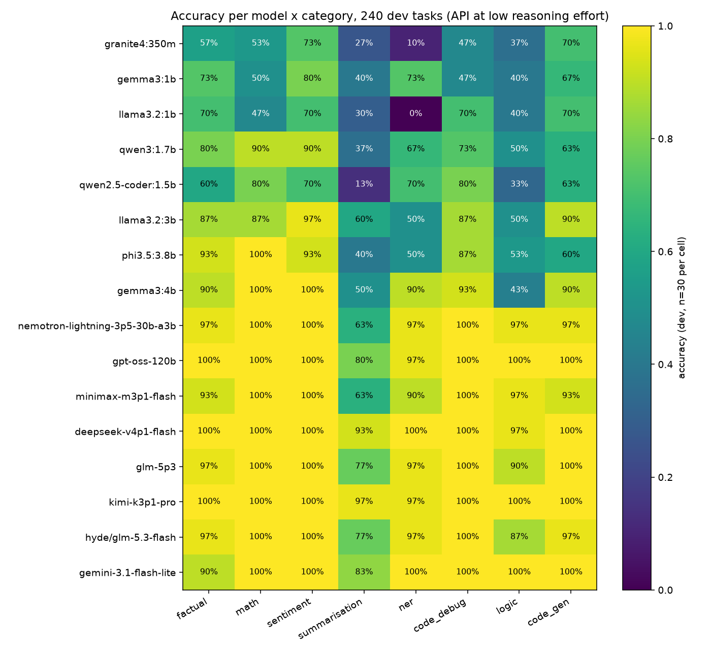
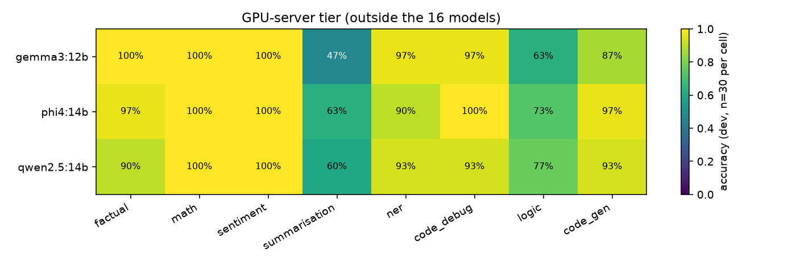
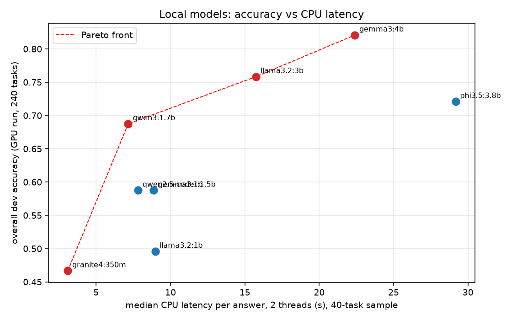
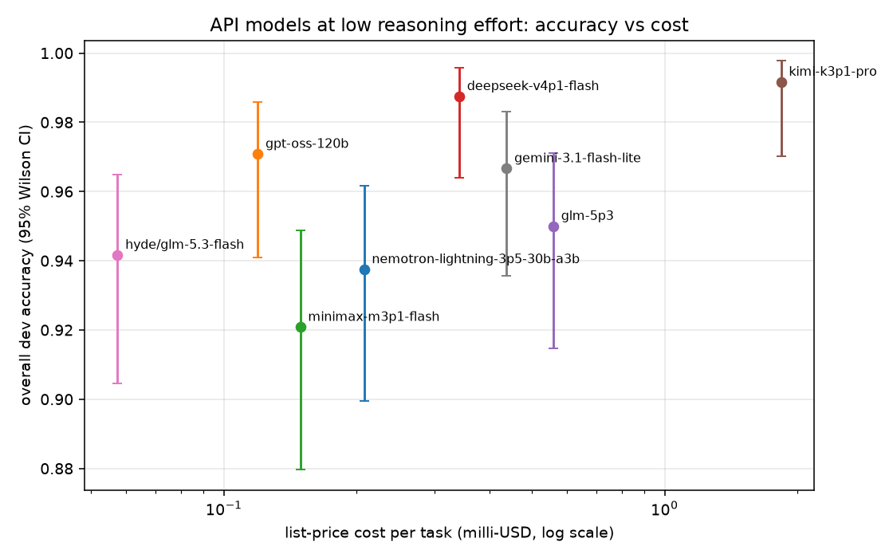

# Phase 3 benchmark report (dev split, 240 tasks per model)

Accuracy = passed / graded with Wilson 95% CI. Judge for factual/summarisation: GLM 5.3 Flash (D8/D10), Qwen for GLM's own answers. API models ran at **low reasoning effort** (D11): B1 is therefore the best model as it would be deployed cheaply, not each model at full strength. Per-cell n is 15 (easy/hard) or 30 (category); read those as indicative. Local accuracy is from the Kaggle T4 run; local CPU speed is from a fixed 40-task sample (2 threads, no GPU). One run per model, temperature 0.

## API models (8)

| model | overall acc [95% CI] | easy | hard | tokens in / out (mean) | reasoning tok | latency p50 / p95 ms | cost per task (list) | unparsed | trunc | call err |
|---|---|---|---|---|---|---|---|---|---|---|
| nemotron-lightning-3p5-30b-a3b | 94% [90%-96%] | 93% | 94% | 115 / 1011 | 942 | 1936 / 5268 | $0.00021 | 1 | 11 | 0 |
| gpt-oss-120b | 97% [94%-99%] | 97% | 98% | 166 / 157 | 63 | 1156 / 2123 | $0.00012 | 0 | 0 | 0 |
| minimax-m3p1-flash | 92% [88%-95%] | 93% | 91% | 288 / 176 | 88 | 1408 / 3940 | $0.00015 | 1 | 1 | 0 |
| deepseek-v4p1-flash | 99% [96%-100%] | 98% | 99% | 126 / 254 | 191 | 1838 / 4560 | $0.00034 | 0 | 0 | 0 |
| glm-5p3 | 95% [91%-97%] | 95% | 95% | 109 / 93 | 26 | 1406 / 2686 | $0.00056 | 0 | 0 | 0 |
| kimi-k3p1-pro | 99% [97%-100%] | 99% | 99% | 195 / 145 | 74 | 4040 / 7695 | $0.00184 | 0 | 0 | 0 |
| hyde/glm-5.3-flash | 94% [90%-96%] | 94% | 94% | 109 / 82 | 16 | 994 / 2216 | $0.00006 | 0 | 0 | 0 |
| gemini-3.1-flash-lite | 97% [94%-98%] | 97% | 97% | 100 / 275 | 154 | 2344 / 22904 | $0.00044 | 0 | 0 | 0 |

## Local models (8), accuracy on GPU, speed on CPU

| model | overall acc [95% CI] | easy | hard | tokens in / out (mean) | reasoning tok | GPU p50 / p95 ms | CPU p50 / p95 s | unparsed | trunc | call err |
|---|---|---|---|---|---|---|---|---|---|---|
| granite4:350m | 47% [40%-53%] | 51% | 42% | 109 / 59 | 0 | 274 / 981 | 3.1 / 9.9 | 28 | 0 | 0 |
| gemma3:1b | 59% [52%-65%] | 68% | 49% | 112 / 115 | 0 | 672 / 2423 | 8.9 / 24.2 | 0 | 2 | 0 |
| llama3.2:1b | 50% [43%-56%] | 57% | 42% | 121 / 112 | 0 | 590 / 2405 | 9.0 / 22.9 | 28 | 7 | 0 |
| qwen3:1.7b | 69% [63%-74%] | 74% | 63% | 119 / 106 | 0 | 586 / 3733 | 7.2 / 28.7 | 0 | 5 | 0 |
| qwen2.5-coder:1.5b | 59% [52%-65%] | 72% | 45% | 111 / 115 | 0 | 490 / 3103 | 7.8 / 43.6 | 2 | 6 | 0 |
| llama3.2:3b | 76% [70%-81%] | 82% | 70% | 121 / 98 | 0 | 1316 / 3712 | 15.8 / 38.8 | 5 | 1 | 0 |
| phi3.5:3.8b | 72% [66%-77%] | 75% | 69% | 122 / 155 | 0 | 1999 / 6490 | 29.2 / 83.4 | 16 | 24 | 3 |
| gemma3:4b | 82% [77%-86%] | 86% | 78% | 114 / 119 | 0 | 1644 / 7462 | 22.4 / 72.9 | 0 | 2 | 0 |

## GPU-server tier (outside the 16): gemma3:12b, phi4:14b, qwen2.5:14b (T4 x2)

| model | overall acc [95% CI] | easy | hard | tokens in / out (mean) | reasoning tok | GPU p50 / p95 ms | CPU p50 / p95 s | unparsed | trunc | call err |
|---|---|---|---|---|---|---|---|---|---|---|
| gemma3:12b | 86% [81%-90%] | 90% | 82% | 114 / 115 | 0 | 5055 / 19774 | - | 0 | 7 | 0 |
| phi4:14b | 90% [86%-93%] | 92% | 88% | 112 / 133 | 0 | 6834 / 36603 | - | 0 | 2 | 0 |
| qwen2.5:14b | 88% [84%-92%] | 92% | 84% | 111 / 110 | 0 | 5314 / 23721 | - | 0 | 1 | 0 |

## Accuracy per category (all difficulties, n=30; Wilson 95% CI)

| model | factual | math | sentiment | summarisation | ner | code_debug | logic | code_gen |
|---|---|---|---|---|---|---|---|---|
| nemotron-lightning-3p5-30b-a3b | 97% [83%-99%] | 100% [89%-100%] | 100% [89%-100%] | 63% [46%-78%] | 97% [83%-99%] | 100% [89%-100%] | 97% [83%-99%] | 97% [83%-99%] |
| gpt-oss-120b | 100% [89%-100%] | 100% [89%-100%] | 100% [89%-100%] | 80% [63%-90%] | 97% [83%-99%] | 100% [89%-100%] | 100% [89%-100%] | 100% [89%-100%] |
| minimax-m3p1-flash | 93% [79%-98%] | 100% [89%-100%] | 100% [89%-100%] | 63% [46%-78%] | 90% [74%-97%] | 100% [89%-100%] | 97% [83%-99%] | 93% [79%-98%] |
| deepseek-v4p1-flash | 100% [89%-100%] | 100% [89%-100%] | 100% [89%-100%] | 93% [79%-98%] | 100% [89%-100%] | 100% [89%-100%] | 97% [83%-99%] | 100% [89%-100%] |
| glm-5p3 | 97% [83%-99%] | 100% [89%-100%] | 100% [89%-100%] | 77% [59%-88%] | 97% [83%-99%] | 100% [89%-100%] | 90% [74%-97%] | 100% [89%-100%] |
| kimi-k3p1-pro | 100% [89%-100%] | 100% [89%-100%] | 100% [89%-100%] | 97% [83%-99%] | 97% [83%-99%] | 100% [89%-100%] | 100% [89%-100%] | 100% [89%-100%] |
| hyde/glm-5.3-flash | 97% [83%-99%] | 100% [89%-100%] | 100% [89%-100%] | 77% [59%-88%] | 97% [83%-99%] | 100% [89%-100%] | 87% [70%-95%] | 97% [83%-99%] |
| gemini-3.1-flash-lite | 90% [74%-97%] | 100% [89%-100%] | 100% [89%-100%] | 83% [66%-93%] | 100% [89%-100%] | 100% [89%-100%] | 100% [89%-100%] | 100% [89%-100%] |
| granite4:350m | 57% [39%-73%] | 53% [36%-70%] | 73% [56%-86%] | 27% [14%-44%] | 10% [3%-26%] | 47% [30%-64%] | 37% [22%-54%] | 70% [52%-83%] |
| gemma3:1b | 73% [56%-86%] | 50% [33%-67%] | 80% [63%-90%] | 40% [25%-58%] | 73% [56%-86%] | 47% [30%-64%] | 40% [25%-58%] | 67% [49%-81%] |
| llama3.2:1b | 70% [52%-83%] | 47% [30%-64%] | 70% [52%-83%] | 30% [17%-48%] | 0% [0%-11%] | 70% [52%-83%] | 40% [25%-58%] | 70% [52%-83%] |
| qwen3:1.7b | 80% [63%-90%] | 90% [74%-97%] | 90% [74%-97%] | 37% [22%-54%] | 67% [49%-81%] | 73% [56%-86%] | 50% [33%-67%] | 63% [46%-78%] |
| qwen2.5-coder:1.5b | 60% [42%-75%] | 80% [63%-90%] | 70% [52%-83%] | 13% [5%-30%] | 70% [52%-83%] | 80% [63%-90%] | 33% [19%-51%] | 63% [46%-78%] |
| llama3.2:3b | 87% [70%-95%] | 87% [70%-95%] | 97% [83%-99%] | 60% [42%-75%] | 50% [33%-67%] | 87% [70%-95%] | 50% [33%-67%] | 90% [74%-97%] |
| phi3.5:3.8b | 93% [79%-98%] | 100% [89%-100%] | 93% [79%-98%] | 40% [25%-58%] | 50% [33%-67%] | 87% [70%-95%] | 53% [36%-70%] | 60% [42%-75%] |
| gemma3:4b | 90% [74%-97%] | 100% [89%-100%] | 100% [89%-100%] | 50% [33%-67%] | 90% [74%-97%] | 93% [79%-98%] | 43% [27%-61%] | 90% [74%-97%] |
| gemma3:12b (server tier) | 100% [89%-100%] | 100% [89%-100%] | 100% [89%-100%] | 47% [30%-64%] | 97% [83%-99%] | 97% [83%-99%] | 63% [46%-78%] | 87% [70%-95%] |
| phi4:14b (server tier) | 97% [83%-99%] | 100% [89%-100%] | 100% [89%-100%] | 63% [46%-78%] | 90% [74%-97%] | 100% [89%-100%] | 73% [56%-86%] | 97% [83%-99%] |
| qwen2.5:14b (server tier) | 90% [74%-97%] | 100% [89%-100%] | 100% [89%-100%] | 60% [42%-75%] | 93% [79%-98%] | 93% [79%-98%] | 77% [59%-88%] | 93% [79%-98%] |

## Accuracy per category, easy tasks (n=15)

| model | factual | math | sentiment | summarisation | ner | code_debug | logic | code_gen |
|---|---|---|---|---|---|---|---|---|
| nemotron-lightning-3p5-30b-a3b | 15/15 [80%-100%] | 15/15 [80%-100%] | 15/15 [80%-100%] | 7/15 [25%-70%] | 15/15 [80%-100%] | 15/15 [80%-100%] | 15/15 [80%-100%] | 15/15 [80%-100%] |
| gpt-oss-120b | 15/15 [80%-100%] | 15/15 [80%-100%] | 15/15 [80%-100%] | 11/15 [48%-89%] | 15/15 [80%-100%] | 15/15 [80%-100%] | 15/15 [80%-100%] | 15/15 [80%-100%] |
| minimax-m3p1-flash | 14/15 [70%-99%] | 15/15 [80%-100%] | 15/15 [80%-100%] | 9/15 [36%-80%] | 15/15 [80%-100%] | 15/15 [80%-100%] | 15/15 [80%-100%] | 14/15 [70%-99%] |
| deepseek-v4p1-flash | 15/15 [80%-100%] | 15/15 [80%-100%] | 15/15 [80%-100%] | 14/15 [70%-99%] | 15/15 [80%-100%] | 15/15 [80%-100%] | 14/15 [70%-99%] | 15/15 [80%-100%] |
| glm-5p3 | 15/15 [80%-100%] | 15/15 [80%-100%] | 15/15 [80%-100%] | 10/15 [42%-85%] | 15/15 [80%-100%] | 15/15 [80%-100%] | 14/15 [70%-99%] | 15/15 [80%-100%] |
| kimi-k3p1-pro | 15/15 [80%-100%] | 15/15 [80%-100%] | 15/15 [80%-100%] | 14/15 [70%-99%] | 15/15 [80%-100%] | 15/15 [80%-100%] | 15/15 [80%-100%] | 15/15 [80%-100%] |
| hyde/glm-5.3-flash | 14/15 [70%-99%] | 15/15 [80%-100%] | 15/15 [80%-100%] | 10/15 [42%-85%] | 15/15 [80%-100%] | 15/15 [80%-100%] | 14/15 [70%-99%] | 15/15 [80%-100%] |
| gemini-3.1-flash-lite | 14/15 [70%-99%] | 15/15 [80%-100%] | 15/15 [80%-100%] | 12/15 [55%-93%] | 15/15 [80%-100%] | 15/15 [80%-100%] | 15/15 [80%-100%] | 15/15 [80%-100%] |
| granite4:350m | 12/15 [55%-93%] | 7/15 [25%-70%] | 12/15 [55%-93%] | 3/15 [7%-45%] | 1/15 [1%-30%] | 11/15 [48%-89%] | 3/15 [7%-45%] | 12/15 [55%-93%] |
| gemma3:1b | 14/15 [70%-99%] | 6/15 [20%-64%] | 13/15 [62%-96%] | 7/15 [25%-70%] | 12/15 [55%-93%] | 10/15 [42%-85%] | 8/15 [30%-75%] | 12/15 [55%-93%] |
| llama3.2:1b | 12/15 [55%-93%] | 8/15 [30%-75%] | 10/15 [42%-85%] | 5/15 [15%-58%] | 0/15 [0%-20%] | 13/15 [62%-96%] | 10/15 [42%-85%] | 11/15 [48%-89%] |
| qwen3:1.7b | 13/15 [62%-96%] | 15/15 [80%-100%] | 15/15 [80%-100%] | 6/15 [20%-64%] | 11/15 [48%-89%] | 11/15 [48%-89%] | 9/15 [36%-80%] | 9/15 [36%-80%] |
| qwen2.5-coder:1.5b | 10/15 [42%-85%] | 14/15 [70%-99%] | 13/15 [62%-96%] | 4/15 [11%-52%] | 13/15 [62%-96%] | 14/15 [70%-99%] | 8/15 [30%-75%] | 11/15 [48%-89%] |
| llama3.2:3b | 13/15 [62%-96%] | 13/15 [62%-96%] | 15/15 [80%-100%] | 9/15 [36%-80%] | 8/15 [30%-75%] | 15/15 [80%-100%] | 10/15 [42%-85%] | 15/15 [80%-100%] |
| phi3.5:3.8b | 14/15 [70%-99%] | 15/15 [80%-100%] | 14/15 [70%-99%] | 5/15 [15%-58%] | 8/15 [30%-75%] | 13/15 [62%-96%] | 8/15 [30%-75%] | 13/15 [62%-96%] |
| gemma3:4b | 14/15 [70%-99%] | 15/15 [80%-100%] | 15/15 [80%-100%] | 8/15 [30%-75%] | 15/15 [80%-100%] | 15/15 [80%-100%] | 7/15 [25%-70%] | 14/15 [70%-99%] |
| gemma3:12b | 15/15 [80%-100%] | 15/15 [80%-100%] | 15/15 [80%-100%] | 7/15 [25%-70%] | 15/15 [80%-100%] | 15/15 [80%-100%] | 13/15 [62%-96%] | 13/15 [62%-96%] |
| phi4:14b | 15/15 [80%-100%] | 15/15 [80%-100%] | 15/15 [80%-100%] | 8/15 [30%-75%] | 15/15 [80%-100%] | 15/15 [80%-100%] | 13/15 [62%-96%] | 14/15 [70%-99%] |
| qwen2.5:14b | 15/15 [80%-100%] | 15/15 [80%-100%] | 15/15 [80%-100%] | 10/15 [42%-85%] | 15/15 [80%-100%] | 14/15 [70%-99%] | 13/15 [62%-96%] | 14/15 [70%-99%] |

## Accuracy per category, hard tasks (n=15)

| model | factual | math | sentiment | summarisation | ner | code_debug | logic | code_gen |
|---|---|---|---|---|---|---|---|---|
| nemotron-lightning-3p5-30b-a3b | 14/15 [70%-99%] | 15/15 [80%-100%] | 15/15 [80%-100%] | 12/15 [55%-93%] | 14/15 [70%-99%] | 15/15 [80%-100%] | 14/15 [70%-99%] | 14/15 [70%-99%] |
| gpt-oss-120b | 15/15 [80%-100%] | 15/15 [80%-100%] | 15/15 [80%-100%] | 13/15 [62%-96%] | 14/15 [70%-99%] | 15/15 [80%-100%] | 15/15 [80%-100%] | 15/15 [80%-100%] |
| minimax-m3p1-flash | 14/15 [70%-99%] | 15/15 [80%-100%] | 15/15 [80%-100%] | 10/15 [42%-85%] | 12/15 [55%-93%] | 15/15 [80%-100%] | 14/15 [70%-99%] | 14/15 [70%-99%] |
| deepseek-v4p1-flash | 15/15 [80%-100%] | 15/15 [80%-100%] | 15/15 [80%-100%] | 14/15 [70%-99%] | 15/15 [80%-100%] | 15/15 [80%-100%] | 15/15 [80%-100%] | 15/15 [80%-100%] |
| glm-5p3 | 14/15 [70%-99%] | 15/15 [80%-100%] | 15/15 [80%-100%] | 13/15 [62%-96%] | 14/15 [70%-99%] | 15/15 [80%-100%] | 13/15 [62%-96%] | 15/15 [80%-100%] |
| kimi-k3p1-pro | 15/15 [80%-100%] | 15/15 [80%-100%] | 15/15 [80%-100%] | 15/15 [80%-100%] | 14/15 [70%-99%] | 15/15 [80%-100%] | 15/15 [80%-100%] | 15/15 [80%-100%] |
| hyde/glm-5.3-flash | 15/15 [80%-100%] | 15/15 [80%-100%] | 15/15 [80%-100%] | 13/15 [62%-96%] | 14/15 [70%-99%] | 15/15 [80%-100%] | 12/15 [55%-93%] | 14/15 [70%-99%] |
| gemini-3.1-flash-lite | 13/15 [62%-96%] | 15/15 [80%-100%] | 15/15 [80%-100%] | 13/15 [62%-96%] | 15/15 [80%-100%] | 15/15 [80%-100%] | 15/15 [80%-100%] | 15/15 [80%-100%] |
| granite4:350m | 5/15 [15%-58%] | 9/15 [36%-80%] | 10/15 [42%-85%] | 5/15 [15%-58%] | 2/15 [4%-38%] | 3/15 [7%-45%] | 8/15 [30%-75%] | 9/15 [36%-80%] |
| gemma3:1b | 8/15 [30%-75%] | 9/15 [36%-80%] | 11/15 [48%-89%] | 5/15 [15%-58%] | 10/15 [42%-85%] | 4/15 [11%-52%] | 4/15 [11%-52%] | 8/15 [30%-75%] |
| llama3.2:1b | 9/15 [36%-80%] | 6/15 [20%-64%] | 11/15 [48%-89%] | 4/15 [11%-52%] | 0/15 [0%-20%] | 8/15 [30%-75%] | 2/15 [4%-38%] | 10/15 [42%-85%] |
| qwen3:1.7b | 11/15 [48%-89%] | 12/15 [55%-93%] | 12/15 [55%-93%] | 5/15 [15%-58%] | 9/15 [36%-80%] | 11/15 [48%-89%] | 6/15 [20%-64%] | 10/15 [42%-85%] |
| qwen2.5-coder:1.5b | 8/15 [30%-75%] | 10/15 [42%-85%] | 8/15 [30%-75%] | 0/15 [0%-20%] | 8/15 [30%-75%] | 10/15 [42%-85%] | 2/15 [4%-38%] | 8/15 [30%-75%] |
| llama3.2:3b | 13/15 [62%-96%] | 13/15 [62%-96%] | 14/15 [70%-99%] | 9/15 [36%-80%] | 7/15 [25%-70%] | 11/15 [48%-89%] | 5/15 [15%-58%] | 12/15 [55%-93%] |
| phi3.5:3.8b | 14/15 [70%-99%] | 15/15 [80%-100%] | 14/15 [70%-99%] | 7/15 [25%-70%] | 7/15 [25%-70%] | 13/15 [62%-96%] | 8/15 [30%-75%] | 5/15 [15%-58%] |
| gemma3:4b | 13/15 [62%-96%] | 15/15 [80%-100%] | 15/15 [80%-100%] | 7/15 [25%-70%] | 12/15 [55%-93%] | 13/15 [62%-96%] | 6/15 [20%-64%] | 13/15 [62%-96%] |
| gemma3:12b | 15/15 [80%-100%] | 15/15 [80%-100%] | 15/15 [80%-100%] | 7/15 [25%-70%] | 14/15 [70%-99%] | 14/15 [70%-99%] | 6/15 [20%-64%] | 13/15 [62%-96%] |
| phi4:14b | 14/15 [70%-99%] | 15/15 [80%-100%] | 15/15 [80%-100%] | 11/15 [48%-89%] | 12/15 [55%-93%] | 15/15 [80%-100%] | 9/15 [36%-80%] | 15/15 [80%-100%] |
| qwen2.5:14b | 12/15 [55%-93%] | 15/15 [80%-100%] | 15/15 [80%-100%] | 8/15 [30%-75%] | 13/15 [62%-96%] | 14/15 [70%-99%] | 10/15 [42%-85%] | 14/15 [70%-99%] |

## Cost (D5)

Marginal local cost is $0. With hardware, a local answer is priced at its measured latency x an assumed rate: CPU instance $0.05/h (2 vCPU, assumption, not from the price table), T4 GPU box $0.35/h (assumption).

| model | CPU latency-priced cost per task | GPU latency-priced cost per task |
|---|---|---|
| granite4:350m | $0.000054 | - |
| gemma3:1b | $0.000157 | - |
| llama3.2:1b | $0.000163 | - |
| qwen3:1.7b | $0.000157 | - |
| qwen2.5-coder:1.5b | $0.000169 | - |
| llama3.2:3b | $0.000249 | - |
| phi3.5:3.8b | $0.000500 | - |
| gemma3:4b | $0.000379 | - |
| gemma3:12b | - | $0.000730 |
| phi4:14b | - | $0.001047 |
| qwen2.5:14b | - | $0.000786 |

Local Pareto front (accuracy vs CPU median latency): granite4:350m, qwen3:1.7b, llama3.2:3b, gemma3:4b.

## Findings

**Strong per category (dev, n=30 per cell, so CIs are wide).**
- **API tier is near the ceiling.** deepseek-v4p1-flash and kimi-k3p1-pro tie at 99% overall; gpt-oss-120b and gemini-3.1-flash-lite are at 97%. Math, sentiment, code debugging and code generation are 97-100% for almost every API model, so the API models barely separate there. The tie at the top means B1 (D2: ties go to the cheaper) will be deepseek-v4p1-flash at about $0.00034 per task vs kimi at $0.00184; `pick_baselines.py` decides, not this report.
- **Summarisation is the one category where API models differ** (63% nemotron/minimax, 77% glm, 80% gpt-oss, 83% gemini, 93% deepseek, 97% kimi). It is also the weakest category for every local model (13-63%).
- **Logic and NER separate the local models.** Logic: all eight local models are 33-53%, even gemma3:4b (43%) that is otherwise strong; the 14B server tier reaches 63-77%; API models 87-100%. NER: gemma3:4b 90%, qwen3:1.7b 67%, llama3.2:3b/phi3.5 50% mostly from ignoring the JSON-only instruction.
- **Local models that already clear 90% on a category (dev point estimates, not yet a policy):** gemma3:4b on math (100%), sentiment (100%), code debugging (93%), NER (90%), code generation (90%) and factual (90%); phi3.5:3.8b on math (100%); qwen3:1.7b on math and sentiment (90%); llama3.2:3b on sentiment (97%). Phase 4 applies the D4 test to these; the lower CI bound is ~74-89% for n=30.
- **Local Pareto front (accuracy vs CPU median latency):** granite4:350m (47%, 3.1 s), qwen3:1.7b (69%, 7.2 s), llama3.2:3b (76%, 15.8 s), gemma3:4b (82%, 22.4 s). phi3.5:3.8b is dominated (72% at 29 s), as are gemma3:1b, qwen2.5-coder:1.5b and llama3.2:1b.
- **GPU-server tier** (gemma3:12b 86%, qwen2.5:14b 88%, phi4:14b 90%) beats every 1-4B local model except by a few points over gemma3:4b (82%), but at 5-7 s per answer on a T4 pair; it does not reach the API tier's accuracy.

**Surprises.**
- The easy/hard label barely separates API models (e.g. kimi 99%/99%, deepseek 98%/99%); it does separate the local models (gemma3:4b 86% vs 78%, qwen3 74% vs 63%). Per-cell n is 15, so D9's difficulty routing will mostly matter for local models.
- qwen2.5-coder:1.5b (code specialist) is the best 1-2B model at code debugging (80%) but only ties the generalists at code generation (63%, vs gemma3:1b 67%, llama3.2:1b 70%), and is the worst at summarisation (13%) and logic (33%).
- qwen3:1.7b (thinking off) is the best small model on math (90%) but its Kaggle re-run was only 138/240 identical to the Phase 2 dry run, while gemma3:1b was 240/240 identical: qwen3 is not fully deterministic at temperature 0 here.
- At low effort, nemotron-lightning spends ~940 reasoning tokens per answer on average (10x the others) and 11 answers ran out of its token budget with an empty or partial reply; 4 of its 11 summarisation failures are empty replies from these runaways (the rest are judge verdicts or limit breaks). minimax had one similar runaway (code_gen-001).
- Gemini's p95 latency is 22.9 s (median 2.3 s) because of the free-tier throttle and retries in the runner; do not read it as model latency.

**Grader artefacts and fixes (recorded; all models re-graded after the change so they stay comparable).**
1. *Language check false positives (fixed).* The D10 check failed correct technical answers because of letter-like symbols (micro sign in "µm", ℏ, ᵀ, superscript ⁿᵗ): 4 API answers (minimax x2, hyde/glm, kimi), all factual. The check now flags only real non-English scripts; genuine leaks still fail (qwen3:1.7b "镑", two qwen2.5:14b answers that drift into Chinese). Test added in `eval/graders/test_language.py`.
2. *Unparsed answers (left strict, no extractor change).* NER answers that are bullet lists or single objects instead of the requested JSON list (granite 24, llama3.2:1b 28, llama3.2:3b 5, qwen2.5-coder 2, phi3.5 13) fail as instruction violations: a router would reject them. Only 5 phi3.5 answers have a valid JSON list followed by extra text, so a lenient parser would change them; not done, to stay consistent with the Phase 2 rule that prose around the JSON fails. granite4:350m code_debug (4) has no code, only a description: genuine failure.
3. *Summaries.* Most summary failures are definite constraint breaks (word/sentence/bullet limits: minimax 8 of 11, gpt-oss 4 of 6) rather than judge verdicts; judge verdicts dominate for glm, gemini, kimi and deepseek.
4. *Call errors.* phi3.5:3.8b returned HTTP 500 on 3 logic prompts (logic-021, -047, -048); counted as failures, not re-run. 24 phi3.5 answers hit the token limit.

**Caveats to say out loud.** API models ran at low reasoning effort (D11), so the API ceiling is "as deployed cheaply"; one run per model at temperature 0; the 40-task CPU sample (5 per category) makes CPU p95 noisy; local accuracy is measured on a Kaggle T4, CPU timing on Kaggle CPUs (2 threads), not on Kabir's laptop; cost rates for the "with hardware" view ($0.05/h CPU, $0.35/h T4) are assumptions, not quotes.

## Spend (Phase 3)

| provider | what | USD |
|---|---|---|
| Fireworks | 6 API models, 240 dev tasks each (+16-task smoke, included) | 0.771 |
| Fireworks | Qwen judge calls for GLM answers during Phase 3 grading | 0.349 |
| **Fireworks total** | cap $5.00 | **1.12** |
| Hyde GLM | free to us; list-price equivalent | 0.014 (list) |
| Gemini AI Studio | free tier; list-price equivalent | 0.105 (list) |
