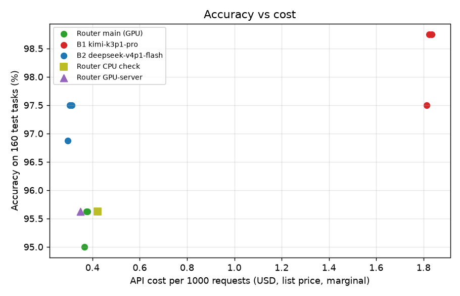
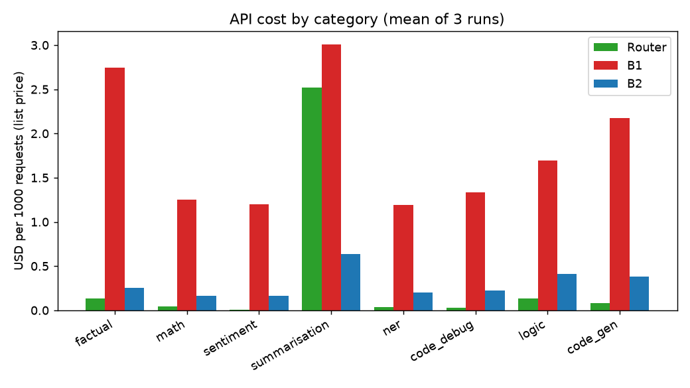
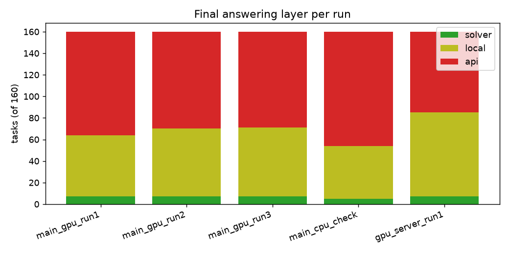

# Phase 6 final report: router vs B1 vs B2 on the 160 held-out test tasks

Frozen at tag `phase6-frozen` (see `FREEZE.md`; no post-freeze fix was needed, so nothing was re-run). All numbers come from `graded_scores.jsonl` (frozen graders and judge: GLM 5.3 Flash, Qwen for GLM's own answers) and the raw files `answers_b1b2.jsonl` and `kaggle_out/phase6_out/*`. Costs are tokens x list price (Hyde GLM and Gemini are priced at list although free to us); cash spend is in section 11. B1 and B2 get the true category's system prompt (as in Phase 3); the router classifies by itself.

## 1. Headline

Mean ± standard deviation over 3 runs (D3). Wilson 95% CI is for the mean accuracy over n = 160 tasks.

| System | Accuracy (3 runs) | Wilson 95% CI | Run values | Cost, 160 tasks (list) | Cost per 1000 requests |
|---|---|---|---|---|---|
| Router (main policy, GPU) | 95.4% ± 0.3% | 91.2% to 97.9% | 95.0%, 95.6%, 95.6% | $0.0596 | $0.37 |
| B1 always kimi-k3p1-pro | 98.3% ± 0.6% | 94.6% to 99.4% | 97.5%, 98.8%, 98.8% | $0.2920 | $1.82 |
| B2 always deepseek-v4p1-flash | 97.3% ± 0.3% | 93.7% to 99.0% | 97.5%, 97.5%, 96.9% | $0.0487 | $0.30 |

| Savings of the router | vs B1 | vs B2 |
|---|---|---|
| **Marginal** (local = $0) | **79.6%** | **-22.6%** |
| **With hardware** (CPU instance $0.05/h x CPU-check latency of each local attempt: +$0.0252 per 160 tasks) | 71.0% | -74.3% |

Accuracy difference router - B1: -2.9 points; router - B2: -1.9 points. B1 costs 6.0x B2.

## 2. Guardrail re-check on test (D12)

Rule: the router is at most 3 points less accurate than B1 at 95% confidence (one-sided paired bootstrap over the 160 tasks, 10,000 resamples, `eval/phase4/policy_lib.noninferior`). Reported as it came out.

| Comparison | Router acc | Reference acc | Observed diff | One-sided 95% lower bound | Result |
|---|---|---|---|---|---|
| router run 1 vs B1 run 1 | 95.0% | 97.5% | -2.5 pts | -5.6 pts | **FAIL** |
| router run 2 vs B1 run 2 | 95.6% | 98.8% | -3.1 pts | -5.6 pts | **FAIL** |
| router run 3 vs B1 run 3 | 95.6% | 98.8% | -3.1 pts | -6.2 pts | **FAIL** |
| **router mean of 3 vs B1 mean of 3** | 95.4% | 98.3% | -2.9 pts | -5.4 pts | **FAIL** |
| router run 1 vs B2 run 1 (informational) | 95.0% | 97.5% | -2.5 pts | -5.6 pts | **FAIL** |
| router run 2 vs B2 run 2 (informational) | 95.6% | 97.5% | -1.9 pts | -5.0 pts | **FAIL** |
| router run 3 vs B2 run 3 (informational) | 95.6% | 96.9% | -1.2 pts | -5.0 pts | **FAIL** |
| B2 run 1 vs B1 run 1 (B2's own D12 test) | 97.5% | 97.5% | +0.0 pts | -1.9 pts | **PASS** |
| B2 run 2 vs B1 run 2 (B2's own D12 test) | 97.5% | 98.8% | -1.3 pts | -3.8 pts | **FAIL** |
| B2 run 3 vs B1 run 3 (B2's own D12 test) | 96.9% | 98.8% | -1.9 pts | -5.0 pts | **FAIL** |

## 3. Per-category results

Accuracy and cost = mean over the 3 runs; cost is the category's total over its test tasks (list price, marginal).

| Category | n | Router acc | B1 acc | B2 acc | Router cost | B1 cost | B2 cost | Savings vs B1 | Savings vs B2 |
|---|---|---|---|---|---|---|---|---|---|
| factual | 20 | 100.0% | 100.0% | 100.0% | $0.0027 | $0.0549 | $0.0051 | 95.1% | 47.5% |
| math | 20 | 98.3% | 100.0% | 100.0% | $0.0009 | $0.0250 | $0.0033 | 96.6% | 73.8% |
| sentiment | 20 | 95.0% | 100.0% | 100.0% | $0.0001 | $0.0240 | $0.0032 | 99.7% | 97.8% |
| summarisation | 20 | 93.3% | 86.7% | 81.7% | $0.0503 | $0.0601 | $0.0128 | 16.3% | -294.6% |
| ner | 20 | 100.0% | 100.0% | 100.0% | $0.0008 | $0.0239 | $0.0040 | 96.7% | 80.3% |
| code_debug | 20 | 81.7% | 100.0% | 100.0% | $0.0006 | $0.0267 | $0.0044 | 97.9% | 87.4% |
| logic | 20 | 96.7% | 100.0% | 96.7% | $0.0027 | $0.0339 | $0.0083 | 92.0% | 67.4% |
| code_gen | 20 | 98.3% | 100.0% | 100.0% | $0.0017 | $0.0435 | $0.0076 | 96.2% | 78.1% |

## 4. Traffic mixes (D6)

Per-category means re-weighted. Shares: equal = 1/8 each; support desk = sentiment, summarisation, NER, factual 25% each; developer tools = code_gen 35%, code_debug 35%, factual / math / logic 10% each (my definition of 'code-heavy'); analyst = math, logic, factual 1/3 each. Cost is per request (list price, marginal).

| Mix | Router acc | B1 acc | B2 acc | Router $/req | B1 $/req | B2 $/req | Savings vs B1 | Savings vs B2 |
|---|---|---|---|---|---|---|---|---|
| equal | 95.4% | 98.3% | 97.3% | $0.00037 | $0.00182 | $0.00030 | 79.6% | -22.6% |
| support desk | 97.1% | 96.7% | 95.4% | $0.00067 | $0.00204 | $0.00031 | 66.9% | -114.9% |
| developer tools | 92.5% | 100.0% | 99.7% | $0.00007 | $0.00180 | $0.00029 | 96.1% | 76.1% |
| analyst | 98.3% | 100.0% | 98.9% | $0.00010 | $0.00190 | $0.00028 | 94.5% | 62.6% |

Range of savings across the mixes: vs B1 **66.9% to 96.1%**, vs B2 -114.9% to 76.1%.

## 5. Paths, escalation, zero-API-cost categories

| Run | solver | local | api (incl. escalated and out-of-scope) | of which escalated after a failed local/translator step | predicted out-of-scope | accuracy |
|---|---|---|---|---|---|---|
| router_main_gpu_run1 | 7 | 57 | 96 | 13 | 7 | 95.0% |
| router_main_gpu_run2 | 7 | 63 | 90 | 7 | 7 | 95.6% |
| router_main_gpu_run3 | 7 | 64 | 89 | 6 | 7 | 95.6% |
| router_main_cpu_check | 5 | 49 | 106 | 23 | 7 | 95.6% |
| router_gpu_server_run1 | 7 | 78 | 75 | 20 | 7 | 95.6% |

**Strict rule for "N of 8 at 0 API cost":** a category counts only if **every** test task of that category (by true category) was answered by a solver or a local model (final layer solver or local, never api) in **all 3** main-policy GPU runs.

| Category | n | share answered at $0 (run 1 / 2 / 3) | Counts under the strict rule |
|---|---|---|---|
| factual | 20 | 60% / 65% / 70% | no |
| math | 20 | 70% / 80% / 80% | no |
| sentiment | 20 | 95% / 100% / 100% | no |
| summarisation | 20 | 0% / 0% / 0% | no |
| ner | 20 | 0% / 0% / 0% | no |
| code_debug | 20 | 50% / 60% / 60% | no |
| logic | 20 | 0% / 0% / 0% | no |
| code_gen | 20 | 45% / 45% / 45% | no |

**Strict count: 0 of 8** categories at 0 API cost.

## 6. Classifier, solver and validator numbers (test split)

Labels are identical in all 5 router runs: True. Out-of-scope recall cannot be measured on the test split (it holds no out-of-scope prompts); only the false-out-of-scope rate.

- **Task-type accuracy:** 153/160 = 95.6% (Wilson 91.2% to 97.9%). In-scope tasks predicted out-of-scope (counted wrong, sent to B2): 7 (4.4%).
- Confusions (true -> predicted): logic->out_of_scope x3, factual->out_of_scope x2, math->out_of_scope x2.
- Label source `rule`: 71 tasks, category accuracy 98.6%.
- Label source `embedding`: 83 tasks, category accuracy 100.0%.
- Label source `embedding-threshold`: 6 tasks, category accuracy 0.0%.
- **Difficulty accuracy** (on the 153 tasks with the right category): 100/153 = 65.4% (Wilson 57.5% to 72.4%).

**Solvers (math and logic).** Coverage = share of math+logic tasks whose final answer came from the solver layer; precision = share of those correct. 'Via translator' = the D13 local-model translator produced the input of the Python solver.

| Run | math+logic tasks | solver answers (coverage) | correct (precision) | via translator | pure-Python parser |
|---|---|---|---|---|---|
| router_main_gpu_run1 | 40 | 7 (17.5%) | 7/7 (100.0%) | 7 | 0 |
| router_main_gpu_run2 | 40 | 7 (17.5%) | 7/7 (100.0%) | 7 | 0 |
| router_main_gpu_run3 | 40 | 7 (17.5%) | 7/7 (100.0%) | 7 | 0 |
| router_main_cpu_check | 40 | 5 (12.5%) | 5/5 (100.0%) | 5 | 0 |
| router_gpu_server_run1 | 40 | 7 (17.5%) | 7/7 (100.0%) | 7 | 0 |

All solver answers on test came through the D13 translator; the pure-Python parser deferred on every math/logic test task (its recipes did not match the unseen phrasings; reasons are in each run's trace), so the solver layer answered 17.5% of math+logic with 100% precision.

**Validators and local answers.** Local attempts (every `local` trace step) split into accepted, rejected by a validator and timed out (30 s budget). A validator 'catch rate' on wrong local answers cannot be computed: rejected answers are not stored or graded. The observable numbers are the rejection share and the precision of accepted local answers (a wrong accepted answer is a validator miss).

| Run | local attempts | accepted | rejected by validator | timed out | other error | accepted & correct | accepted & wrong (misses) |
|---|---|---|---|---|---|---|---|
| router_main_gpu_run1 | 70 | 57 | 4 | 9 | 0 | 52 | 5 |
| router_main_gpu_run2 | 70 | 63 | 7 | 0 | 0 | 58 | 5 |
| router_main_gpu_run3 | 70 | 64 | 6 | 0 | 0 | 59 | 5 |
| router_main_cpu_check | 72 | 49 | 6 | 17 | 0 | 43 | 6 |
| router_gpu_server_run1 | 98 | 78 | 6 | 14 | 0 | 72 | 6 |

**Every wrong answer whose final layer was a local model or a solver:**

| System | Task | True category | Layer | Model | Grader detail |
|---|---|---|---|---|---|
| router_main_gpu_run1 | code_debug-011 | code_debug | local | qwen2.5-coder:1.5b | 1/4 tests passed; first error: AssertionError:  |
| router_main_gpu_run1 | code_debug-028 | code_debug | local | qwen2.5-coder:1.5b | 1/4 tests passed; first error: AssertionError:  |
| router_main_gpu_run1 | code_debug-033 | code_debug | local | qwen2.5-coder:1.5b | 3/5 tests passed; first error: AssertionError:  |
| router_main_gpu_run1 | code_gen-013 | code_gen | local | llama3.2:3b | 4/7 tests passed; first error: ValueError: Invalid operator |
| router_main_gpu_run1 | sent-050 | sentiment | local | gemma3:4b | got mixed want neutral via answer_line |
| router_main_gpu_run2 | code_debug-009 | code_debug | local | qwen2.5-coder:1.5b | 0/5 tests passed; first error: AssertionError:  |
| router_main_gpu_run2 | code_debug-011 | code_debug | local | qwen2.5-coder:1.5b | 1/4 tests passed; first error: AssertionError:  |
| router_main_gpu_run2 | code_debug-028 | code_debug | local | qwen2.5-coder:1.5b | 1/4 tests passed; first error: AssertionError:  |
| router_main_gpu_run2 | code_debug-033 | code_debug | local | qwen2.5-coder:1.5b | 3/5 tests passed; first error: AssertionError:  |
| router_main_gpu_run2 | sent-050 | sentiment | local | gemma3:4b | got mixed want neutral via answer_line |
| router_main_gpu_run3 | code_debug-009 | code_debug | local | qwen2.5-coder:1.5b | 0/5 tests passed; first error: AssertionError:  |
| router_main_gpu_run3 | code_debug-011 | code_debug | local | qwen2.5-coder:1.5b | 1/4 tests passed; first error: AssertionError:  |
| router_main_gpu_run3 | code_debug-028 | code_debug | local | qwen2.5-coder:1.5b | 1/4 tests passed; first error: AssertionError:  |
| router_main_gpu_run3 | code_debug-033 | code_debug | local | qwen2.5-coder:1.5b | 3/5 tests passed; first error: AssertionError:  |
| router_main_gpu_run3 | sent-050 | sentiment | local | gemma3:4b | got mixed want neutral via answer_line |
| router_main_cpu_check | code_debug-009 | code_debug | local | qwen2.5-coder:1.5b | 0/5 tests passed; first error: AssertionError:  |
| router_main_cpu_check | code_debug-011 | code_debug | local | qwen2.5-coder:1.5b | 1/4 tests passed; first error: AssertionError:  |
| router_main_cpu_check | code_debug-028 | code_debug | local | qwen2.5-coder:1.5b | 1/4 tests passed; first error: AssertionError:  |
| router_main_cpu_check | code_debug-033 | code_debug | local | qwen2.5-coder:1.5b | 3/5 tests passed; first error: AssertionError:  |
| router_main_cpu_check | fact-042 | factual | local | phi3.5:3.8b | needs blind judge |
| router_main_cpu_check | sent-050 | sentiment | local | gemma3:4b | got mixed want neutral via answer_line |
| router_gpu_server_run1 | code_debug-009 | code_debug | local | qwen2.5-coder:1.5b | 0/5 tests passed; first error: AssertionError:  |
| router_gpu_server_run1 | code_debug-011 | code_debug | local | qwen2.5-coder:1.5b | 1/4 tests passed; first error: AssertionError:  |
| router_gpu_server_run1 | code_debug-028 | code_debug | local | qwen2.5-coder:1.5b | 1/4 tests passed; first error: AssertionError:  |
| router_gpu_server_run1 | code_debug-033 | code_debug | local | qwen2.5-coder:1.5b | 3/5 tests passed; first error: AssertionError:  |
| router_gpu_server_run1 | code_gen-013 | code_gen | local | llama3.2:3b | 4/7 tests passed; first error: ValueError: Invalid operator |
| router_gpu_server_run1 | sent-050 | sentiment | local | gemma3:4b | got mixed want neutral via answer_line |

**All wrong answers by final layer** (3 main GPU runs pooled): solver 0/21, local 15/184, api 7/275.

## 7. Why the API count differs across the 3 GPU runs (96 / 90 / 89)

| Run | api | local | solver | local timeouts | validator rejections | wall clock |
|---|---|---|---|---|---|---|
| main_gpu_run1 | 96 | 57 | 7 | 9 | 4 | 502 s |
| main_gpu_run2 | 90 | 63 | 7 | 0 | 7 | 251 s |
| main_gpu_run3 | 89 | 64 | 7 | 0 | 6 | 230 s |

Run 1 had **9 local timeouts** (each used the whole 30 s budget, so the task was escalated to the API); runs 2 and 3 had **0 and 0**. Run 1 timeouts (position of the task in the file, model, ms): [(1, 'phi3.5:3.8b', 30082), (3, 'phi3.5:3.8b', 30075), (21, 'gemma3:4b', 29464), (22, 'qwen3:1.7b', 29449), (23, 'qwen3:1.7b', 29030), (24, 'gemma3:4b', 26688), (41, 'llama3.2:3b', 30066), (101, 'qwen2.5-coder:1.5b', 30064), (102, 'qwen2.5-coder:1.5b', 30091)]. Position of the first use of each model in run 1: {'phi3.5:3.8b': 1, 'gemma3:4b': 21, 'qwen3:1.7b': 22, 'llama3.2:3b': 41, 'qwen2.5-coder:1.5b': 101}. The timeouts sit at the first uses of each model (and at model swaps), where Ollama has to load the weights after a fresh `ollama pull`; by run 2 they are cached and no call came close to the budget. Run 1 also took about twice as long on the wall clock. So the gap between run 1 and runs 2/3 is a **cold-start effect**, not model nondeterminism.

Final-route differences: run 1 vs 2 = 8 tasks, run 1 vs 3 = 9, run 2 vs 3 = 1. The remaining difference between runs 2 and 3 (and the extra validator rejection in run 2) is GPU sampling, which is not bit-exact even at temperature 0. The cold start is a real property of a freshly started server, so run 1 stays in the 3-run mean ± spread; the effect is shown, not removed.

## 8. CPU-deployment check (1 run: CPU only, 2 threads, 30 s budget)

| | CPU check | main GPU run 2 (warm) | main GPU mean of 3 |
|---|---|---|---|
| Accuracy | 95.6% | 95.6% | 95.4% |
| solver / local / api | 5 / 49 / 106 | 7 / 63 / 90 | 7 / 61 / 92 |
| Cost (list, marginal) | $0.0674 | $0.0605 | $0.0596 |
| Cost with hardware (CPU $0.05/h) | $0.0926 | $0.0857 | $0.0848 |
| Latency p50 / p95 / max (s per request) | 62.8 / 242.9 / 321.0 | 4.8 / 40.6 / 56.6 | |
| Local or translator steps that hit the 30 s budget | 17 | 0 | |
| Local step latency p50 / p95 (s, timeouts excluded) | 9.6 / 24.2 | 1.3 / 6.0 | |
| Savings vs B1 / B2, marginal | 76.9% / -38.5% | | 79.6% / -22.6% |
| Savings vs B1 / B2, with hardware | 68.3% / -90.3% | | 71.0% / -74.3% |

Request latency in `router.run` includes queueing: 8 requests run concurrently but local-model calls are serialised (one at a time), so a request waits for the local lane. The per-step local latency row is the cleaner per-call number; request latency is a batch-throughput figure, not what a single user on a CPU box would see.

Guardrail for the CPU check vs the B1 mean: diff -2.7 pts, lower bound -5.6 pts, **FAIL**. This run is the honest deployment number for a CPU-only box: the GPU runs overstate the local share, because local answers that take longer than 30 s on 2 CPU threads fall through to the API.

## 9. GPU-server scenario (`routing_policy_gpu_server.json`, 1 run on a T4)

| | GPU-server router | main router (GPU mean) | B1 | B2 |
|---|---|---|---|---|
| Accuracy | 95.6% | 95.4% | 98.3% | 97.3% |
| solver / local / api | 7 / 78 / 75 | 7 / 61 / 92 | 0 / 0 / 160 | 0 / 0 / 160 |
| API cost, 160 tasks (list) | $0.0557 | $0.0596 | $0.2920 | $0.0487 |
| + hardware (T4 $0.35/h x measured local latency = $0.0933) | $0.1490 | $0.0848 (CPU-priced) | | |
| Savings vs B1, marginal / with hardware | 80.9% / 49.0% | 79.6% / 71.0% | | |
| Savings vs B2, marginal / with hardware | -14.5% / -206.3% | -22.6% / -74.3% | | |

Guardrail vs the B1 mean: diff -2.7 pts, lower bound -5.6 pts, **FAIL**. Single run, so no spread. The hardware price counts only the GPU seconds used by local steps; an always-on box costs far more per request at low traffic.

## 10. Data quality

- Judge returned no verdict (counted wrong): 0 of 1760 answers.
- Non-English-script failures (D10): 0 (none).
- Grader could not parse the answer: 0 (none).
- Call errors: 0.

## 11. Spend

- B1 + B2 on the laptop (Fireworks): $1.0218. Router on Kaggle, 5 runs (Fireworks only): $0.2928. Judge: GLM via Hyde is free; Qwen (Fireworks) is used only for GLM-answered factual/summary items (see `grade_run.log` / `judge_cache.jsonl`). Phase cap: $3.

## 12. Plots

## 13. Headline numbers

| Question | Measured on the held-out test set |
|---|---|
| Cost saving | **79.6%** vs B1 (marginal), 71.0% with hardware; -22.6% vs the cheaper B2; traffic mixes 67% to 96% vs B1; CPU-only deployment 76.9% (marginal) |
| Accuracy | router 95.4% ± 0.3% vs B1 98.3% ± 0.6%; guardrail vs B1 **FAILED** (lower bound -5.4 pts, margin -3) |
| Scope of the evaluation | 16 models x 8 categories on 240 dev tasks (Phase 3); policy derived on dev only; final test on 160 held-out tasks |
| Categories at 0 API cost (strict rule) | **0 of 8** (none); per-run shares in section 5 |

Nothing above was tuned after the test split was opened.
